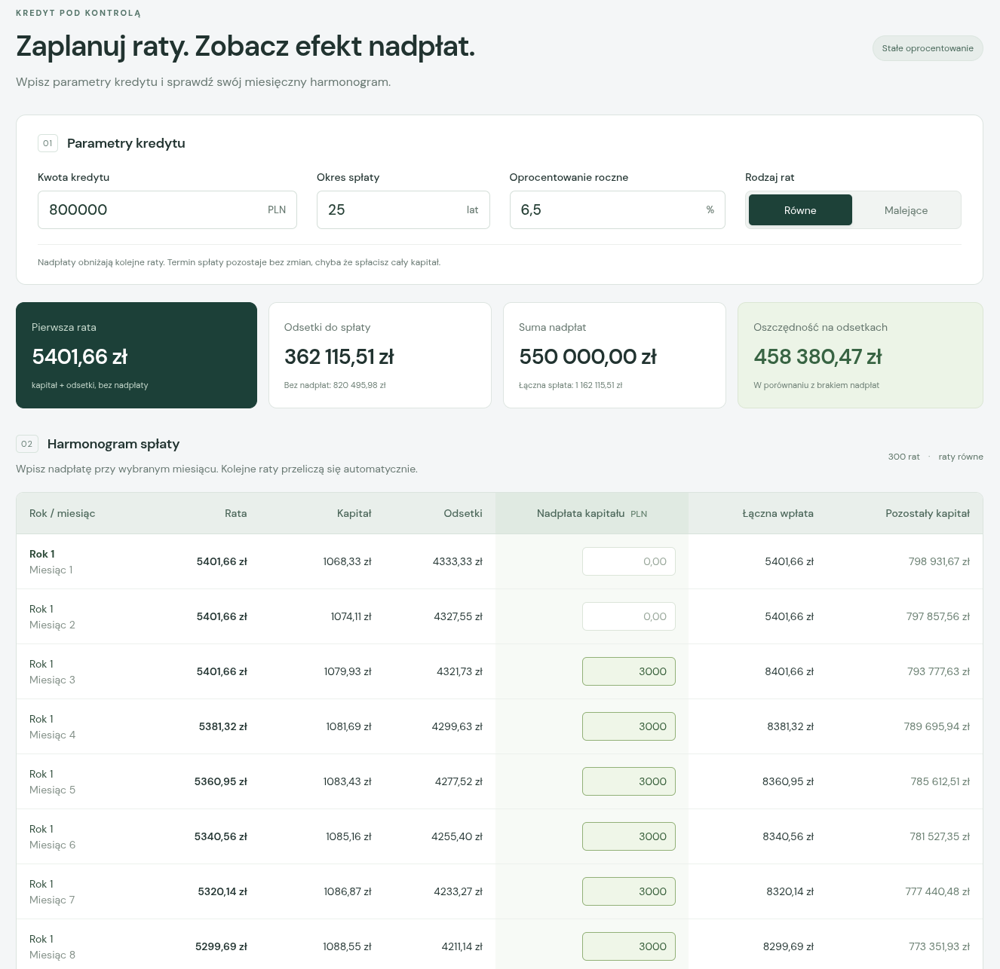

# Hipoteka - Mortgage and Early Repayment Calculator

A React + TypeScript + Vite application for simulating a mortgage repayment schedule, including optional monthly overpayments.

The calculator interface on the frontend is presented in Polish, so labels, helper text, and messages are localized for Polish-speaking users.



## Local Setup

Requirements: Node.js 22.18 or newer, and npm.

Unpack the ZIP, open a terminal in the project directory, and run:

```sh
npm ci
npm run dev
```

Then open the URL shown in the terminal in your browser.

Note: installing dependencies requires an internet connection.

## Calculation Tests

```sh
npm test
```

## Production Build

```sh
npm run build
```

If the build completes successfully, Vite creates a dist directory in the project root with production-ready static files that can be deployed to any static hosting service.

## Key Files

- src/loan.ts - amortization logic (calculated in grosz, i.e. integer cents)
- src/loan.test.ts - calculation tests
- src/main.tsx - form, summary cards, and repayment table
- src/style.css - visual styling and responsive layout

## Assumptions

- Fixed annual interest rate.
- Monthly interest is calculated as: principal x annual rate / 12.
- Overpayments are applied after the monthly installment and reduce future installments while keeping the original term.
- Full payoff ends the schedule early.
- Amounts are rounded to grosz.
- No commissions, insurance, or additional bank fees are included.
- Entered data is not persisted after a page refresh.

## Disclaimer

- This calculator is intended for personal use only.
- The results are estimates and are not guaranteed.
- Each bank may use slightly different formulas, rounding rules, and repayment policies, so official bank schedules can differ from this simulation.
- This calculator does not include commission costs or other bank charges.

## AI Disclosure

This project was developed with the assistance of Artificial Intelligence (AI). AI tools were used to support code generation, implementation, and documentation.
